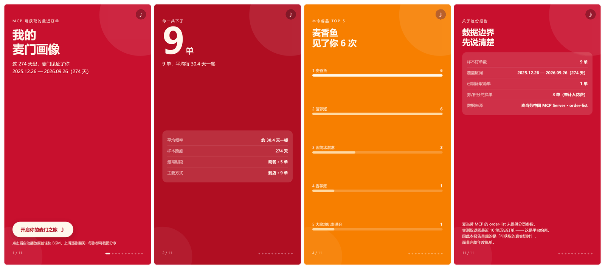
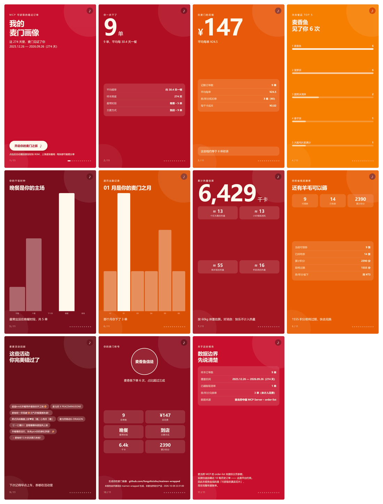

<div align="center">

# 麦门画像 · maimen-wrapped

**基于麦当劳 MCP 生成你的个人消费故事卡片流**

最多 11 张 9:16 全屏卡片 · 逐张翻阅 · 每张都可截图分享 · 自带原创 BGM

[](https://www.python.org/)
[](LICENSE)
[](https://open.mcd.cn/mcp)

</div>

---

> 参赛项目 · 麦当劳程序员节创意开发大赛。本项目由参赛者独立开发，**非麦当劳官方产品**。

## 效果预览

> 下列截图由本项目**真实运行输出**（示例数据，全虚构）逐张抓取，非设计稿。

<div align="center">



<sub>封面 · 总单数 · 本命餐品 · 数据边界说明（左右滑动查看完整卡片流）</sub>

<br><br>



<sub>完整 11 张卡片总览</sub>

</div>

**3 秒看懂**：打开报告 → 上滑逐张翻阅 → 每张都是 9:16 全屏、可直接截图发朋友圈。

```bash
# 无需任何 Token，一行命令立刻看到上面这些卡片
python -m maimen_wrapped --from-json examples/sample_data.json --out my_report.html
```

## 这是什么

`maimen-wrapped` 读取你自己的麦当劳历史订单，生成一份像 Spotify Wrapped 那样的**故事卡片流**——最多 11 张竖版全屏卡片，上滑逐张翻阅：

| 卡片 | 内容 |
| --- | --- |
| 1 | 封面 · 统计区间 |
| 2 | 总单数（超大数字冲击） |
| 3 | 总花费 + 生活化换算 |
| 4 | 本命餐品 Top 5 |
| 5 | 干饭时钟（早/午/下午茶/晚/夜宵分布） |
| 6 | 逐月出勤记录 |
| 7 | 累计热量换算 |
| 8 | 省钱武器库（券 + 积分） |
| 9 | 错过的麦麦活动 |
| 10 | **专属麦门称号** + 六格数据回顾 |
| 11 | 数据边界说明（样本量 / 覆盖区间 / 剔除项） |

称号卡会按你的数据发放称号：**麦香鱼信徒**、**深夜麦乐送战士**、**早餐狂魔**、**板烧鸡腿堡信徒**……

## ⚠️ 关于数据边界（请先读这一段）

麦当劳 MCP 的 `order-list` 工具**未定义任何入参**，官方文档仅说明「查询近期的到店/外送历史订单」。实测：

- 尝试 `pageNum` / `page` / `pageSize` / `limit` / `offset` / 日期区间等 **14 种参数组合**，均返回**完全相同的 10 条订单**
- 这 10 条跨越约 **9 个月**（非固定 60 天窗口），与麦当劳 App 端历史订单口径一致
- 结论：**10 单是平台固有约束，不是接口缺陷，也无法突破**

因此本项目**如实标注数据边界**，而非宣称「年度报告」：封面注明样本范围，末卡专设「数据边界说明卡」，列明样本订单数、覆盖区间、已剔除的取消单、券/积分兑换单。**我们认为诚实标注样本量，比用「年度账单」的噱头更站得住脚。**

在 10 单的约束下，项目通过三项数据清洗让样本价值最大化：

| 清洗动作 | 为什么必须做 |
| --- | --- |
| **套餐拆解** `comboItemList` | 9/10 单是套餐。不拆解则「本命餐品」全是「精选超值随心配」，毫无传播力；拆解后得到「麦香鱼 6 次」 |
| **保留零元单** | 券/积分兑换单 `realTotalAmount="0"`，丢弃会损失约 30% 样本。保留但不计入花费 |
| **过滤取消单** | `orderStatus="订单已取消"` 会虚增单数。过滤但单独计数，在边界卡如实展示 |

## 快速开始

### 0. 先看效果（30 秒，不需要 Token）

```bash
git clone https://github.com/fengzhizishu/maimen-wrapped.git
cd maimen-wrapped
pip install -r requirements.txt
python -m maimen_wrapped --from-json examples/sample_data.json --out my_report.html
```

用浏览器打开 `my_report.html`，点击封面按钮即可翻阅全部 11 张卡片。

### 1. 申请麦当劳 MCP Token

1. 访问 <https://open.mcd.cn/mcp>
2. 使用手机号验证登录
3. 点击右上角「控制台」→「激活」申请 MCP Token，一键复制

> 麦当劳 MCP 服务面向中国大陆地区（不含港澳台）提供。

### 2. 安装

```bash
git clone https://github.com/fengzhizishu/maimen-wrapped.git
cd maimen-wrapped
pip install -r requirements.txt
```

依赖仅一个：官方 `mcp` SDK。其余全部使用 Python 标准库。

### 3. 配置 Token

三选一：

```bash
# 方式一：环境变量
export MCD_MCP_TOKEN=你的Token          # Windows PowerShell: $env:MCD_MCP_TOKEN="你的Token"

# 方式二：配置文件（推荐）
cp .env.example .env && 编辑 .env 填入 Token

# 方式三：命令行参数
python -m maimen_wrapped --token 你的Token
```

若你希望在 **WorkBuddy / Cursor / Cherry Studio / TRAE** 等 MCP Client 中直接挂载麦当劳 MCP，
可直接使用仓库根目录的 [`mcp-config.example.json`](mcp-config.example.json)：

```json
{
  "mcpServers": {
    "mcd-mcp": {
      "type": "streamablehttp",
      "url": "https://mcp.mcd.cn",
      "headers": {
        "Authorization": "Bearer ${MCD_MCP_TOKEN}"
      }
    }
  }
}
```

> ⚠️ 该文件仅使用环境变量占位符 `${MCD_MCP_TOKEN}`，**不含任何真实凭据**，可安全提交。
> 接入 Client 前请先设置环境变量 `MCD_MCP_TOKEN`。

### 4. 生成你的麦门画像

```bash
python -m maimen_wrapped
```

完成后用浏览器打开 `output/maimen-wrapped.html`，点击封面卡「开启你的麦门之旅」即可开始翻阅。

## 命令行参数

| 参数 | 说明 |
| --- | --- |
| `--token <TOKEN>` | 指定 MCP Token（优先级最高） |
| `--probe` | 探查模式：dump 各工具返回结构，便于核对字段 |
| `--from-json <FILE>` | 离线模式：从本地 JSON 生成报告，**无需 Token** |
| `--out <PATH>` | 输出路径（默认 `output/maimen-wrapped.html`） |
| `--repo <URL>` | 报告中展示的仓库地址 |
| `--cache` | 复用本地营养表缓存，减少网络请求 |
| `--quiet` | 精简输出 |

首次接入建议先跑探查模式，确认当前账号的数据字段：

```bash
python -m maimen_wrapped --probe --token 你的Token
```

结果保存在 `data/probe/`，其中 `SCHEMA_REPORT.md` 是字段核对清单。

## 数据流

```
order-list（历史订单）
      │
      ├─→ query-order（并发补全订单详情，限速 5 并发 + 429 指数退避）
      │
list-nutrition-foods（餐品营养表）
      │
      ├─→ 餐品名三级匹配（归一化精确 → 模糊匹配 → aliases.json 兜底）
      │
query-my-account / available-coupons / query-my-coupons / campaign-calendar
      │
      ▼
   聚合统计 + 称号规则引擎
      │
      ▼
   单文件 HTML 卡片流（内联 CSS/JS，零外部资源）
```

## 设计要点

### 缺数据自动降级

不同账号的订单数据完整度不同。报告对缺失数据自动降级，**不编造**：

| 缺失数据 | 处理方式 |
| --- | --- |
| 无金额字段 | 隐藏花费卡，主打单数与出勤率 |
| 无下单时刻 | 隐藏干饭时钟卡 |
| 营养匹配率 < 50% | 热量卡降级并标注匹配率 |
| 完全无订单数据 | 出「积分与优惠画像」简版 |

卡片自动跳过，进度页码动态重排。

### 原创 BGM（零音频文件）

报告自带一段原创轻快背景音乐——**用 Web Audio API 现场合成**，约 100 行代码，不是任何现成曲目，也不引用任何音频文件：

- C 大调五声音阶原创动机 + 低音声部，三角波 + ADSR 包络
- 右上角常驻静音开关
- 遵循浏览器自动播放策略，由封面卡按钮触发

### 隐私与合规

- **只读调用**：仅使用查询类工具，绝不调用下单、取消、抽奖等写操作
- Token 只经命令行参数/环境变量/`.env` 传入，**不存储、不上传**
- 全部原始数据仅落本地 `data/`、`output/`，均已在 `.gitignore` 中忽略
- 不使用麦当劳 logo、金拱门图形、官方字体或任何商标素材
- 示例数据 (`examples/sample_data.json`) 完全虚构

## 参与共建

欢迎提 PR 补充 [`src/maimen_wrapped/aliases.json`](src/maimen_wrapped/aliases.json)——订单里的餐品名与营养表名称常有差异，映射表越全，大家的营养匹配率越高。跑一次 `--probe` 就能看到有哪些餐品没匹配上。

## 使用的麦当劳 MCP 工具

详见 [`MCP_INTEGRATION.md`](MCP_INTEGRATION.md)。

## 许可证

[MIT](LICENSE)

---

<div align="center">

**生成你的麦门画像，看看这一年麦门见证了什么 🍔**

</div>
